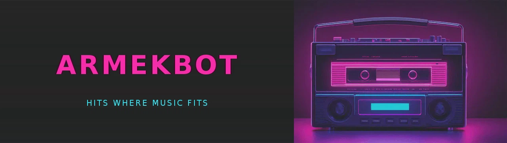

[](https://pkg.go.dev/github.com/ArmaRizki/ArmekBot) [](https://github.com/ArmaRizki/ArmekBot/releases) [](LICENSE)

# ArmekBot

A self-hosted Discord music bot written in Go, with a terminal player thrown in.
It streams YouTube, SoundCloud and internet radio, and it's built around one
stubborn idea: **playback should survive** — flaky streams, dead voice
connections, gateway reconnects, all of it.

Public music bots come and go, usually with a cease-and-desist attached.
ArmekBot is the opposite deal: a small binary you run yourself, with your own
token, on your own machine. Nobody can turn it off for you.

> ArmekBot is a rebranded fork of [keshon/melodix](https://github.com/keshon/melodix)
> (MIT). The Discord voice layer was rebuilt for modern Discord (AEAD + DAVE
> encryption), and playback got a good share of fixes on top.

## What it does well

- **Refuses to drop a track.** Every track has several extraction backends
  (ytnative, kkdai, yt-dlp, plain ffmpeg). If a stream dies mid-play, ArmekBot
  reopens it at the same position; if a backend keeps failing, it falls through
  to the next.
- **Survives Discord too.** A silent gateway or a dead voice connection is
  detected and recovered automatically, and queues live through session restarts.
- **Keeps a memory.** `/history` shows what was played; `/play 42` replays
  entry 42. No link hunting.
- **Stays small.** One binary, no database server. Storage is an embedded
  write-ahead-logged datastore in one directory. FFmpeg and yt-dlp are optional.
- **Doubles as a terminal player.** The same engine drives `armekbot-cli`,
  which plays straight to your speakers. Good for testing, also just for listening.

## Try it

Bring your own bot: create an application in the
[Discord Developer Portal](https://discord.com/developers/applications), copy
`.env.example` to `.env`, and fill in your token. The full walkthrough —
invite link, permissions, every config knob, Docker — is in
[docs/running.md](docs/running.md).

Prebuilt binaries are on the [releases page](https://github.com/ArmaRizki/ArmekBot/releases).

## Quick start

```bash
# Discord bot — token from the Discord Developer Portal
go build -o armekbot-discord ./cmd/discord
DISCORD_TOKEN=your-token ./armekbot-discord

# ...or the terminal player, no Discord account required
go build -o armekbot-cli ./cmd/cli
./armekbot-cli
```

FFmpeg and yt-dlp are optional — YouTube plays by Opus passthrough without
either. The full setup guide — creating the bot, invite link, every config
knob, Docker — is in [docs/running.md](docs/running.md).

## Commands

<!-- generated -->

### 🕯️ Information

- **/about** — Discover the origin of this bot
- **/help** — Get a list of available commands
  - **/help category** — View commands grouped by category
  - **/help group** — View commands grouped by group
  - **/help flat** — View all commands as a flat list

### 🎵 Music

- **/history** — Show recently played tracks (replay by id with /play)
- **/join** — Make the bot join your voice channel and stay (24/7 mode)
- **/leave** — Disable 24/7 mode and leave the voice channel
- **/next** — Skip to the next track
- **/play** — Play a music track
- **/stop** — Stop playback and clear queue

### ⚙️ Settings

- **/maintenance** — Bot maintenance commands
  - **/maintenance ping** — Check bot latency
  - **/maintenance download-db** — Download the current server database as a JSON file
  - **/maintenance status** — Retrieve statistics about the guild
- **/settings** — Server settings
  - **/settings commands log** — Review recently used commands
  - **/settings commands status** — Show enabled and disabled command groups
  - **/settings commands enable** — Enable a command group
  - **/settings commands disable** — Disable a command group


<!-- /generated -->

`/play` takes more than links:

```text
/play never gonna give you up                       search query (YouTube)
/play https://www.youtube.com/watch?v=dQw4w9WgXcQ   direct link (YouTube / SoundCloud)
/play http://stream-uk1.radioparadise.com/aac-320   internet radio stream
/play 42                                            replay entry 42 from /history
```

## Under the hood

The playback engine ([pkg/music](pkg/music)) is a standalone Go library with
no Discord in it: resolver → queue → recovery stream → sink. The Discord bot
is one consumer of it, the CLI is another. If you're curious how the parser
fallback and voice recovery actually work, [docs/architecture.md](docs/architecture.md)
walks through the whole thing.

The codebase keeps itself honest: the house rules — naming, concurrency
contracts, how to add a source or parser — are written down in
[docs/conventions.md](docs/conventions.md), and CI enforces the mechanical
half (vet, race-enabled tests, a lint config that passes with zero findings).

## License

[MIT](LICENSE)
